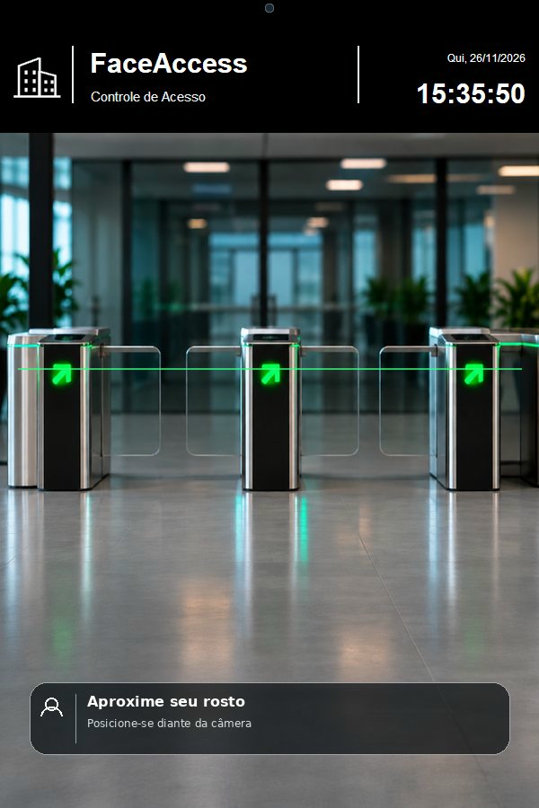

# FaceAccess — Reconhecimento Facial

Projeto acadêmico desenvolvido para a disciplina de **Visão Computacional**, da pós-graduação em **Data Science e Inteligência Artificial — Senac**.

O FaceAccess simula um terminal de controle de acesso por reconhecimento facial. O sistema compara o rosto capturado pela webcam com as fotografias cadastradas localmente e apresenta o resultado de identificação em uma interface personalizada.

## Interface

  

*Prévia ilustrativa do terminal aguardando identificação.*

## Funcionalidades

- Cadastro facial pela webcam.
- Reconhecimento de rostos cadastrados em tempo real.
- Simulação de acesso liberado ou negado.
- Interface com cenário de catracas, remoção de fundo, scanner animado e mensagens de identificação.

## Tecnologias utilizadas

| Tecnologia | Finalidade |
|---|---|
| Python 3.12 | Linguagem de programação |
| OpenCV | Captura e processamento de imagens |
| Dlib e Face Recognition | Detecção e reconhecimento facial |
| MediaPipe | Remoção do fundo da webcam |
| CustomTkinter | Interface gráfica |
| Pillow e NumPy | Manipulação de imagens e operações numéricas |

## Como executar (Windows)

1. Instale o Python 3.12 de 64 bits.
2. Clone o repositório e execute `instalar.bat`. Quando solicitado, informe o arquivo Dlib do professor compatível com Python 3.12 (`cp312-cp312-win_amd64.whl`).
3. Execute `cadastrar.bat`, informe o nome e pressione Espaço ou A para capturar a fotografia.
4. Execute `iniciar.bat` para abrir o terminal com reconhecimento facial.

As fotografias permanecem na pasta local `rostos/` e não são enviadas ao Git.

O reconhecimento está no `main.py`, o cadastro no `cadastrar.py` e a interface no `design.py`.

> Protótipo acadêmico. A catraca e as mensagens representam uma simulação; o projeto não deve ser utilizado como mecanismo único de autenticação real.
